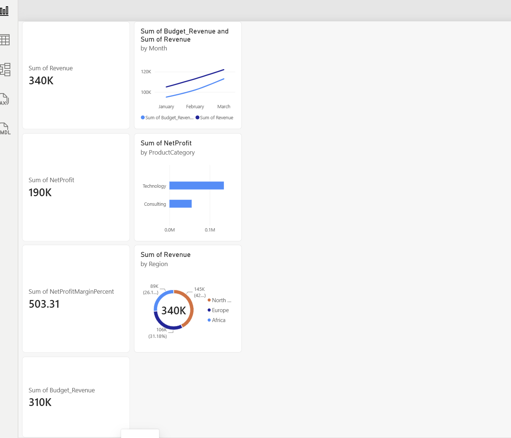

# Executive Financial Performance & Budget Variance Dashboard

## Overview
This interactive Power BI dashboard provides executive-level financial analysis using revenue, cost, and budget data modeled from SQL Server. The project analyzes overall organizational performance, evaluates product profitability, tracks monthly actual vs. budgeted revenue targets, and breaks down regional market contributions.

---

## Tech Stack & Tools
* *Database Management:* SQL Server Management Studio (SSMS) / SQL
* *Business Intelligence & Visualization:* Power BI Desktop
* *Data Modeling:* Data transformations, measure creation, and KPI calculations

---

## Data Architecture & Key Metrics

### Core Metrics Engineered
* *Total Revenue:* Total sales generated over the analysis period ($340K).
* *Net Profit:* Revenue calculated after subtracting COGS and OpEx ($190K).
* *Net Profit Margin (%):* Ratio evaluating operational efficiency.
* *Budget Variance (%):* Actual revenue performance against projected budget targets ($310K budget).

---

## Dashboard Features & Visualizations

1. *Executive KPI Scorecards:*
   * High-level summary of *Total Revenue, **Net Profit, **Net Profit Margin %, and **Budget Variance %*.

2. *Monthly Performance Trend (Line Chart):*
   * Plotted Revenue vs. Budget_Revenue over time to monitor monthly financial variance and target tracking.

3. *Profitability by Category (Clustered Bar Chart):*
   * Evaluated NetProfit across product lines (Technology vs. Consulting) to identify top revenue drivers.

4. *Regional Market Breakdown (Donut Chart):*
   * Analyzed regional sales distribution across *North America, **Europe, and **Africa*.
